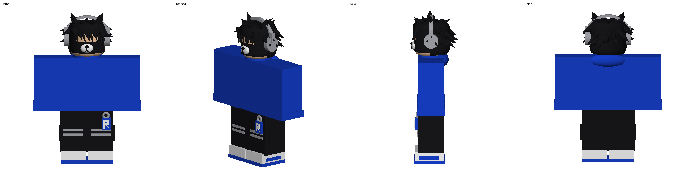

# Roblox-Figur als 3D-Druck-Modell

Der Avatar (R6) mit blauer Hoodie, schwarzen Emo-Haaren mit Katzenohren, grauen Kopfhörern,
Bären-Maske, „SPACE“-Schriftzug hinten, schwarzer Cargo-Hose mit „R“-Anhänger und Hufeisen-Logos hinten und blau-weißen Sneakern.

**Größe:** ca. 6,5 cm hoch × 4,7 cm breit × 2,1 cm tief – so groß wie eine offizielle Roblox-Spielfigur.

## Dateien

| Datei | Wofür |
|---|---|
| `roblox_figur.stl` | **Zum Drucken in einer Farbe.** Ein einziger, geschlossener Körper. |
| `roblox_figur_farbig.3mf` | Für Mehrfarb-Drucker (z. B. Bambu AMS, Prusa MMU): Teile nach Farbe getrennt. |
| `mehrfarbig/figur_*.stl` | Dieselben Farbteile einzeln (schwarz, blau, weiß, grau, haut) – zusammen in den Slicer laden. |
| `roblox_figur.usdz` | **Auf dem iPad/iPhone ansehen:** in der Dateien-App antippen – drehen, zoomen und per „AR“ in echter Größe auf den Tisch stellen. (`python3 make_usdz.py`) |
| `roblox_figur_farbig.glb` | Farbige 3D-Ansicht (z. B. im Browser oder 3D-Viewer). |
| `generate.py` | Skript, das alles erzeugt. Andere Größe: `python3 generate.py 80` (= 80 mm hoch). |

## Drucktipps

- Aufrecht drucken (Füße auf dem Druckbett), **Stützstrukturen an** (für Arme, Haar-Spikes, Kopfhörer).
- 0,12–0,16 mm Schichthöhe, 0,4-mm-Düse, 15 % Infill.
